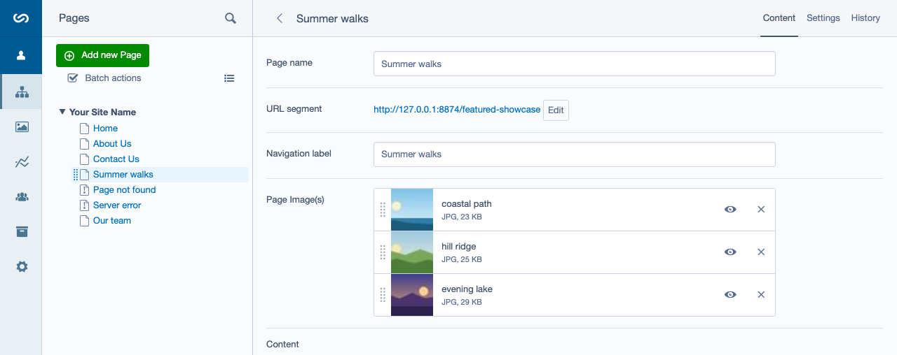
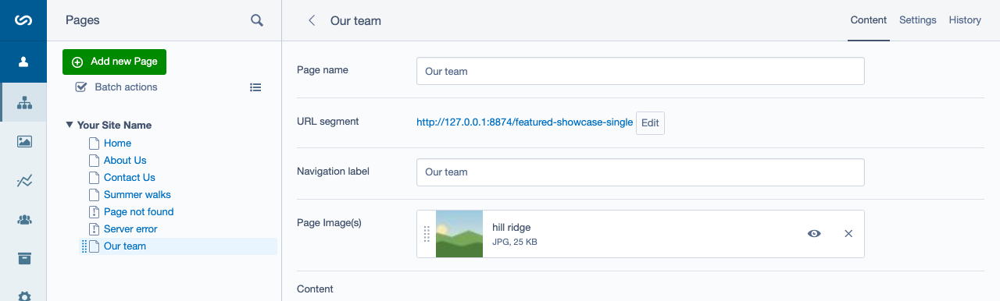

# Featured images for Silverstripe

Add one or more featured images to any Silverstripe page type, with a configurable maximum. Apply
one extension and the page gets a sortable "Page Image(s)" upload field; templates get the images
back in the order the editor dragged them into, and publishing the page publishes its images. For
Silverstripe 5 and 6.



*Maintained by [Restruct](https://github.com/restruct). If this module saves you time, you can
[support ongoing maintenance](https://github.com/sponsors/restruct).*

## A page has no image of its own

Silverstripe pages come with a title and content, but no image field. Most sites want one: a hero
or header image, a thumbnail for listings and teasers, an image for social sharing. Adding it by
hand means the same work on every project: a relation to `Image`, an upload field in the right
place on the edit form, a sort column if there can be more than one, and an `$owns` entry so the
image is not left in draft when the page is published.

## One extension, one sortable image field

Apply `FeaturedImageExtension` to a page type (or to `Page`, for all of them) and that page type
gets:

- a **"Page Image(s)" upload field** on the Content tab, right above the Content editor (at the
  end of the Main tab when the page type has no Content field), limited to image files;
- **drag-and-drop ordering** through
  [bummzack/sortablefile](https://github.com/bummzack/sortablefile), with the order stored on the
  relation;
- a **configurable maximum** number of images: one by default. At the limit the field stops
  offering uploads;
- uploads into their own **`pageimages` folder** (configurable);
- **publishing with the page**: the images are owned by the page (`$owns`), so publishing the page
  publishes them too;
- **template methods** for the first image, all images in order, and images taken from parent or
  child pages.

With the default of one image, the field takes a single file:



### Using the images in templates

```html
<%-- The first image, by the order set in the CMS --%>
<% if $PageImage %>
    $PageImage.Fill(1200, 600)
<% end_if %>

<%-- All images, in that order --%>
<% loop $PageImages %>
    $Me
<% end_loop %>
```

`$FeaturedImage` is an alias of `$PageImage`. `$FeaturedImages` is the raw relation and is **not**
sorted; use `$PageImages`, or `$FeaturedImages.Sort('SortOrder')`.

### Images from parent or child pages

Two methods fetch images from elsewhere in the site tree, for example a section header image that
subpages inherit, or a strip of thumbnails from a holder's children. Pass `1` or `0` for the flags
in templates: the methods treat any non-empty string as true, so a `false` that reaches them as
the string `"false"` would switch the flag on.

- **`FirstFeaturedImagesUpTheHierarchy($includeOwn = false)`**: the images of the nearest parent
  page that has any. With `$includeOwn`, the page's own images if it has some, before looking at
  its parents. Every page up the tree must have the extension, so apply it to `Page` when using
  this. Returns an empty list when nothing is found, or when the page type has no hierarchy.

  ```html
  <% with $FirstFeaturedImagesUpTheHierarchy(1).First %>$Fill(1600, 400)<% end_with %>
  ```

- **`DescendantsFeaturedImages($includeOwn = false, $recursively = false)`**: the images of the
  page's children (all children, including pages hidden from menus), or with `$recursively` of all
  its descendants, and with `$includeOwn` its own as well. Only pages of the same class as the
  page itself (or a subclass) are included: called on a `Page`, that is every page.

  ```html
  <% loop $DescendantsFeaturedImages(0, 1).Limit(6) %>$Fill(300, 200)<% end_loop %>
  ```

Neither list is sorted by the CMS order; sort or limit it in the template as needed. The second
argument of `FirstFeaturedImagesUpTheHierarchy` (`$recursively`) is accepted but not used.

### Checking for a `[featuredimage]` marker in the content

`ContentHasFeaturedImageShortcode()` returns true when the page's Content contains the text
`[featuredimage]` (case-insensitive), false when it does not, and null when Content is empty. A
template can use it to skip the image above the content when an editor placed a marker in the text.
The module does not register a `[featuredimage]` shortcode handler: rendering the marker is up to
the project.

## Technical

### Version compatibility

| Branch | Module version | Silverstripe | PHP |
|--------|----------------|--------------|-----|
| `main` | `5.x` | `^5 \|\| ^6` | `^8.1` |
| (tags only) | `4.1.x` | `^4 \|\| ^5 \|\| ^6` | `^7.4 \|\| ^8.0` |
| (tags only) | `4.0.x` | `^6` | `^8.3` |
| (tags only) | `3.x` | `^4 \|\| ^5` | `^7.1 \|\| ^8.0` |

Silverstripe 4 reached end of life in April 2025 and is no longer supported or tested here. Projects
still on it should stay on the `3.x` or `4.1.x` tags, which remain available.

`main` is the only maintained line: it supports every Silverstripe version this module still
targets, so there is no separate maintenance branch. A version branch will be created only when a
change cannot be made compatible across the supported range.

**`composer.json` is the source of truth** for exact constraints; this table is a quick reference.

### Requirements and installation

- Silverstripe 5 or 6 (`silverstripe/cms`)
- PHP 8.1 or newer
- [bummzack/sortablefile](https://github.com/bummzack/sortablefile), installed as a dependency

```bash
composer require restruct/silverstripe-featuredimages
```

### Applying the extension

Add it to the page types that need images, in your project's YAML config, then flush and build
the database (`sake dev/build flush=1` on Silverstripe 5, `sake db:build --flush` on 6):

```yaml
Page:
  extensions:
    - Restruct\SilverStripe\FeaturedImages\FeaturedImageExtension
  # Optional, default 1
  max_featured_images: 3
```

### Configuration reference

Both options are read from the page's own class, so a subclass can set its own value.

```yaml
Page:
  # Maximum number of images in the field (default 1). null for no limit.
  max_featured_images: 1

  # Folder in Files that uploads go into (default "pageimages").
  upload_folder: 'pageimages'
```

The field label comes from the translation key `FeaturedImage.FeaturedImages` (default "Page
Image(s)"); override it in your project's `lang/` files.

### Data model

The images are a `many_many` relation `FeaturedImages` to `Image`, with an `Int` `SortOrder` extra
field holding the CMS order. The join table is named after the page type's table, for example
`Page_FeaturedImages`. The relation is in `$owns`, so the images are published with the page.

### Upgrading from 1.x

1.x stored a single image in a `has_one` `FeaturedImage`. 2.x replaced it with the `many_many`
above and migrated the data on the fly; that migration is no longer part of the module. If you
still have 1.x data, see [docs/legacy-has_one-migration.md](docs/legacy-has_one-migration.md).

### Running the tests

The module cannot be tested on its own: it needs a host Silverstripe project. Require it there
through a Composer **path repository with `symlink: true`** - `/tests` is `export-ignore`, so a dist
or mirrored install contains no tests - add its test namespace to the host's `autoload-dev`, then:

```bash
# Silverstripe 5 (PHPUnit 9) - the path must come before flush=1
vendor/bin/phpunit vendor/restruct/silverstripe-featuredimages/tests flush=1

# Silverstripe 6 (PHPUnit 11) - a flush=1 argument is ignored, use the env var. The
# "featuredimages" test suite is defined in the host's phpunit.xml (see ci.yml).
SS_PHPUNIT_FLUSH=1 vendor/bin/phpunit --testsuite featuredimages
```

CI runs the same suite against Silverstripe 5 and 6 on every push; see
`.github/workflows/ci.yml`, which also shows the host `phpunit.xml`.

Browser tests (Playwright, against a real CMS) live in `tests/browser/` and run in
`.github/workflows/browser-tests.yml`. The screenshots in this README are generated from the same
fixtures; see [tests/browser/screenshots/README.md](tests/browser/screenshots/README.md) to
regenerate them.

### License

BSD-3-Clause, see [LICENSE](LICENSE).
